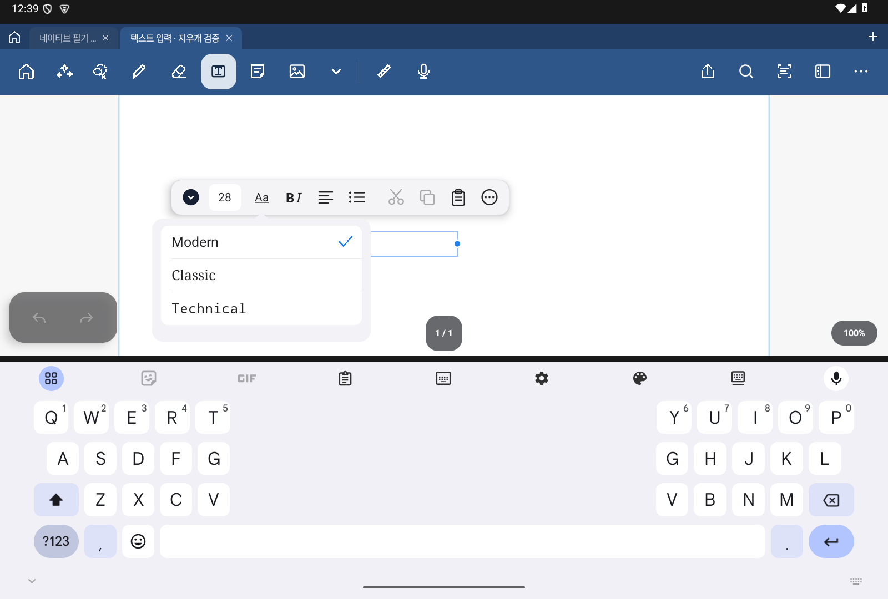
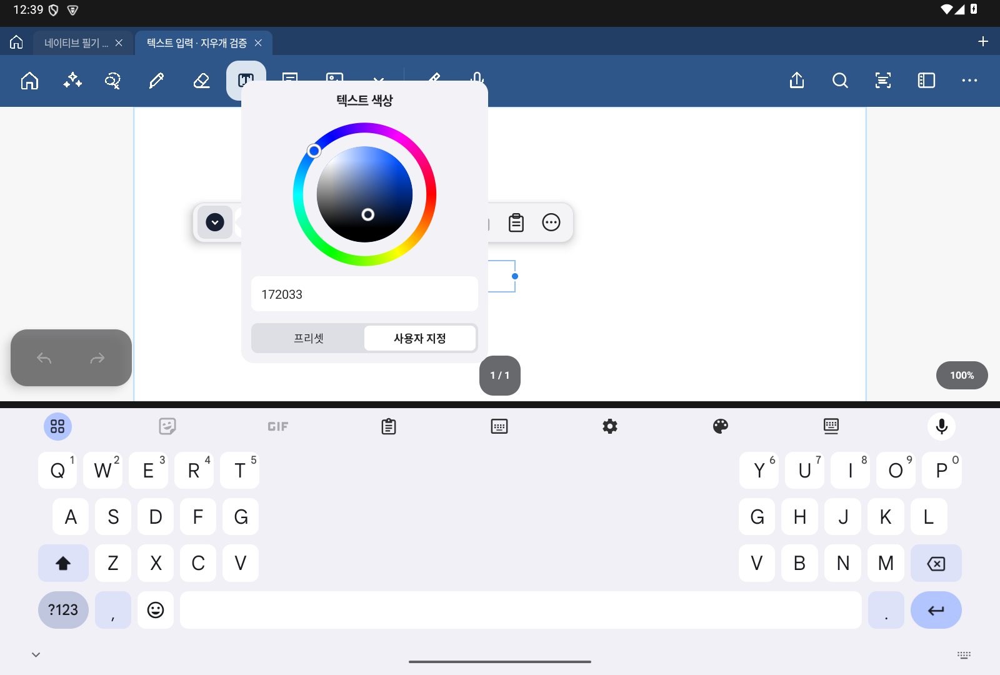
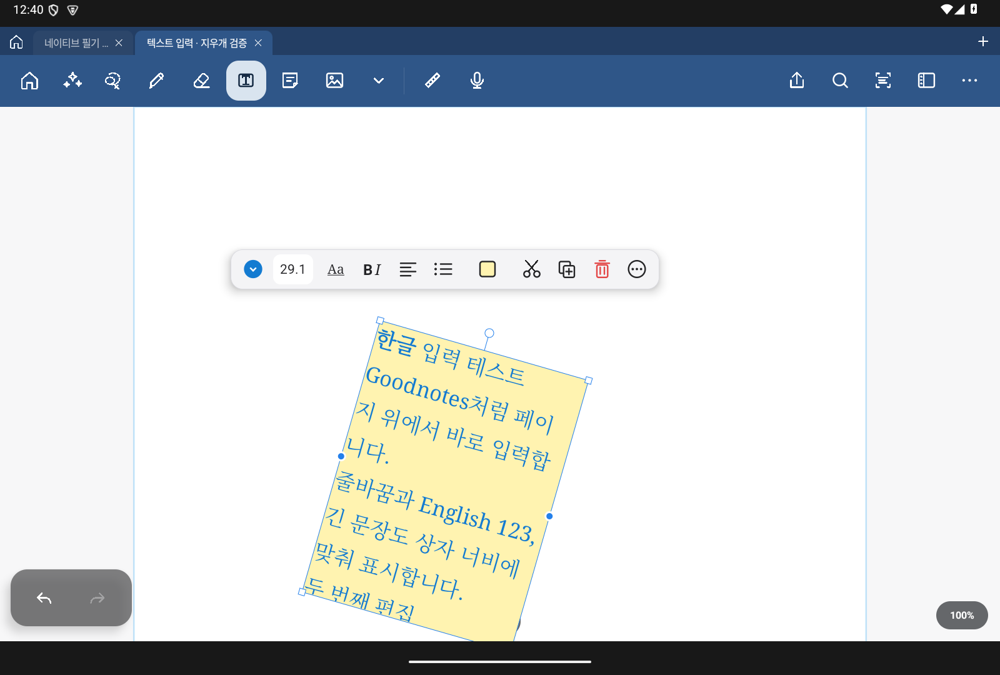

# 4.1.4 Beta 1 PR 검증

2026-10-27, 버전 `4.1.4-beta.1` / 코드 421. 공개 `d6873da` 이후의 누적 개선을 대상으로 확인했다.

| 검사 | 결과 |
| --- | --- |
| `:app:testUpdateDebugUnitTest` | 187개 / 28 suites, 실패·오류·건너뜀 0개 |
| `:app:lintUpdateDebug` | Error/Fatal 0개, Warning 144개 |
| Debug·AndroidTest 빌드 | 통과 |
| `run_native_validation.py tools` | 5개 회귀 묶음 통과 |
| API 35, 1202dp, `textEditingOnly` | 실제 터치·저장·지우개 검사 통과 |
| Debug APK 검증 | 코드 421, 패키지·버전명·서명·ZIP 무결성·16KiB 정렬·PDFium 일치 |
| GitHub Actions 워크플로 | actionlint 1.7.12 통과 |

터치 검사는 한글 조합, 선택/커서 서식, 빈 상자 미리보기, 글꼴·크기·색상·상자 메뉴, 상자 이동·폭 변경·모서리 확대·회전·회전된 폭 조절의 기준점, 저장/재열기·실행 취소/다시 실행을 포함한다. 정밀 지우개는 텍스트·도형·형광펜의 원 내부/외부 픽셀, 잠금·숨김 보호, S Pen 버튼 경로와 취소를 확인했다.

PR 준비 중 발견한 API 23 색상 밝기 호출을 AndroidX 호환 함수로 바꿨다. 하드웨어 그리기의 API 29 조건과 글꼴·줄바꿈 상수를 명시했다. 플랫폼 Activity/IME를 사용하는 입력창에는 해당 구조를 설명하는 AppCompat lint 예외만 적용했다. 수정 후 위 빌드·lint·실제 터치 검사를 다시 통과했다.

## 검증 화면

이번 4.1.4 Beta 1 Debug 앱에서 합성 테스트 문서로 캡처했다.

## 범위와 게시 조건

로컬 검사에는 공개 배포 키를 사용하지 않았다. 공개 업데이트 APK는 원본 저장소의 배포 워크플로가 기존 인증서로 서명하고 검증해야 한다. 로컬 Debug 검사를 공개판 업데이트 설치 검증으로 해석하지 않는다.

고밀도 필기의 표시 지연은 남아 있으며 전체 장시간 계측을 이번 PR 준비에서 반복하지 않았다. 물리 Galaxy/S Pen, 사람 필기의 OCR 정확도, API 23 실제 실행 및 iPad 실기기 비교는 미검증이다. 기존 단계의 결과와 제한은 [필기 캐시 기록](INK-LOCAL.3-KO.md), [OCR 기록](OCR-NATIVE-IMPLEMENTATION-KO.md), [텍스트 UI 기록](TEXT-UI-LOCAL.6-KO.md)을 따른다.

로컬 원시 기록: `build/beta141-native-validation-final.log`, `build/beta141-tools/`, `build/beta141-text-checks.log`, `build/beta141-debug-apk-verification.json`. 원시 빌드 산출물·APK·로컬 설정·서명 키는 소스 커밋에 포함하지 않는다.
